# Fincan Arası

> ## Yönetici Panelini Dene
>
> [Şifresiz yönetici demosunu aç](https://fincan-arasi-demo.netlify.app/yonetici)
>
> Demo yalnız kurgusal, bellek içi veriler kullanır; yapılan değişiklikler sayfa yenilenince sıfırlanır ve Supabase'e gönderilmez. Asıl [canlı uygulamanın](https://fincan-arasi.netlify.app) yönetici paneli Supabase Auth ve allowlist ile korunmaya devam eder.

Fincan Arası, tek bir kafenin dağınık sözlü geri bildirimleri güvenli ve izlenebilir bir dijital akışta toplaması için geliştirilmiş ders projesidir. Müşteriler hesap açmadan öneri, sorun veya teşekkür iletir; önceden tanımlanmış tek yönetici ise bu kayıtları ayrı bir çalışma alanında değerlendirir.

- Canlı uygulama: [https://fincan-arasi.netlify.app](https://fincan-arasi.netlify.app)
- Şifresiz yönetici demosu: [https://fincan-arasi-demo.netlify.app/yonetici](https://fincan-arasi-demo.netlify.app/yonetici)
- Kaynak kod: [https://github.com/rna03/fincan-arasi](https://github.com/rna03/fincan-arasi)
- Production kaynağı: GitHub `main` dalı, yayımlanan uygulama commit'i `2bd95c3`

## Problem, çözüm ve kullanıcılar

Kafelerde fikirler çoğunlukla sözlü iletilir, kaybolur veya daha sonra hangi adımın atıldığı izlenemez. Fincan Arası bunu iki yüzlü bir uygulamayla çözer:

| Kullanıcı | Yetki ve sorumluluk |
| --- | --- |
| Müşteri | Kimlik veya iletişim bilgisi vermeden tür, kategori, başlık ve açıklama ile yeni geri bildirim **oluşturur**. Başka kayıtları okuyamaz; durum, iç not veya geçmiş alanlarına erişemez. |
| Yönetici | Allowlist ve aktif Supabase Auth oturumu doğrulandıktan sonra kayıtları **okur**, arar ve filtreler; yalnız durum ile iç notu **günceller**; kayıt ve bağlı geçmişi **siler**. |

CRUD eşlemesi bilinçli olarak sınırlıdır: müşteri `Create`; yönetici `Read`, yönetim alanlarında `Update` ve onaylı `Delete` yapar. Müşterinin özgün başlık ve açıklaması yönetici tarafından değiştirilemez. Yetki yalnız arayüzde bırakılmaz; yönetici RPC'leri aktif session ve allowlist'i sunucuda yeniden denetler.

## Özellikler

- Mobil uyumlu, kısa müşteri formu; alan doğrulaması ve karakter sayaçları
- Öneri / sorun / teşekkür türleri ile Menü / Hizmet / Atmosfer / Diğer kategorileri
- Cloudflare Turnstile korumalı canlı gönderim
- Arama ve tür, kategori, durum filtrelerini birlikte kullanan yönetici listesi
- Kayıt detayı, durum, iç not, durum geçmişi ve kategori özeti
- Optimistic concurrency ile çakışma bildirimi ve geçmişle birlikte onaylı silme
- Supabase Auth e-posta/şifre girişi, nötr parola kurtarma ve yeni şifre ekranları
- RLS, daraltılmış grant'ler ve allowlist/aktif-session kontrollü RPC katmanı
- Edge Function içinde yöntem, origin, içerik türü, 10 KiB akış gövdesi, enum/uzunluk, Turnstile, rate-limit ve idempotency doğrulaması
- Geliştirme araçlarını yalnız açık demo yapılandırmasında gösteren güvenli mod ayrımı

## Teknolojiler

| Teknoloji | Sürüm hattı | Kullanım |
| --- | --- | --- |
| React / React DOM | 19.3.1 | Arayüz ve durum yönetimi |
| React Router | 7.18.5 | SPA route'ları |
| Vite | 8.3.6 | Geliştirme ve production build |
| Tailwind CSS | 4.3.x | Tasarım sistemi |
| Supabase JS | 2.119.0 | Auth, RPC ve Edge Function istemcisi |
| PostgreSQL / pgTAP | Supabase tarafından yönetilir | Veri, RLS, RPC ve veritabanı güvenlik testleri |
| Cloudflare Turnstile | Managed widget | Müşteri, giriş ve recovery bot koruması |
| Vitest / ESLint | 5.1.0 / 9.39.5 | Birim-servis testi ve statik kontrol |
| GitHub / Netlify | Free plan | Sürüm kontrolü ve `main` dalından canlı yayın |

Geliştirme için Node.js 22.18.0 veya üzeri ve npm 10+ kullanın.

## Kurulum

```bash
git clone https://github.com/rna03/fincan-arasi.git
cd fincan-arasi
npm install
```

Bellek içi demo modu:

```bash
npm run dev
```

Anahtarsız, geliştirici test araçları kapalı demo derlemesi:

```bash
npm run build:demo
```

Gerçek Supabase modu, aşağıdaki browser-safe ortam değerleri sağlandıktan sonra:

```bash
npm run dev:live
```

Örnek isimler [.env.example](./.env.example) dosyasındadır. Gerçek değerler `.env.local` içinde tutulur ve Git'e alınmaz.

| Değişken | Amaç |
| --- | --- |
| `VITE_DATA_MODE` | Açık veri modu: `demo` veya `supabase` |
| `VITE_ENABLE_DEMO_TOOLS` | Yalnız demo modunda ve açıkça `true` ise test araçları |
| `VITE_SUPABASE_URL` | Browser-safe Supabase proje URL'si |
| `VITE_SUPABASE_PUBLISHABLE_KEY` | Browser-safe publishable anahtar |
| `VITE_TURNSTILE_SITE_KEY` | Browser-safe Turnstile site key |

Supabase secret/service-role anahtarı, Turnstile secret ve rate-limit hash secret hiçbir `VITE_` değişkenine, frontend build'ine veya Git deposuna konmaz. Sunucu tarafı örnek isimler `supabase/functions/.env.example` içindedir.

## Demo ve canlı mod farkı

| Konu | Demo | Canlı |
| --- | --- | --- |
| Veri | Modül belleğindeki kurgusal kayıtlar | Supabase PostgreSQL |
| Kalıcılık | Tam sayfa yenilemede başlangıç verisine döner | Yetkili gerçek CRUD ve yenileme kalıcılığı |
| Yönetici girişi | Şifresiz arayüz önizlemesi; gerçek auth değildir | Supabase Auth + aktif session + allowlist |
| İnsan doğrulaması | Kullanılmaz | Turnstile istemci ve sunucu doğrulaması |
| Test araçları | Yalnız `npm run dev:tools` | Production build'de kapalı |

Demo ekranına gerçek veya kişisel veri girilmemelidir. Eksik canlı yapılandırma sessizce demoya düşmez; açık yapılandırma hatası verir.

## Route'lar

| Yol | Ekran |
| --- | --- |
| `/` | Müşteri geri bildirim formu ve başarı durumu |
| `/yonetici/giris` | Yönetici girişi |
| `/yonetici/sifremi-unuttum` | Nötr parola kurtarma isteği |
| `/yonetici/sifre-yenile` | Yeni şifre veya geçersiz/süresi dolmuş bağlantı durumu |
| `/yonetici` | Korumalı yönetici çalışma alanı |
| Diğer yollar | Markalı 404 sayfası |

## Komutlar

```bash
npm run test       # 42 birim/servis testi
npm run test:watch # Vitest izleme modu
npm run lint       # ESLint, sıfır uyarı hedefi
npm run build      # Demo production build
npm run build:live # Supabase production build; public env değerleri gerekir
npm run preview    # dist önizlemesi
npm run test:db    # Çalışan yerel Supabase stack üzerinde pgTAP
```

Netlify yapılandırması `npm run build:live` komutunu ve `dist` yayın klasörünü kullanır. `public/_redirects` SPA fallback'i; `public/_headers` CSP, HSTS, `nosniff`, frame, referrer ve Permissions-Policy başlıklarını sağlar.

## Doğrulama kanıtları

Bu bölüm geçmişte gerçekten çalıştırılmış kontrolleri, bu dokümantasyon turunda yapılan görsel kontrolle karıştırmaz.

### Yerel birim, servis ve build kontrolleri

Depodaki son kayıtlı tam koşu 9 Kasım 2026'dadır; bu belge/görsel güncellemesinde kaynak kod değişmediği için tekrar çalıştırılmadı.

- Vitest: **42/42** geçti. Bunlar altı dosyadaki demo CRUD/geçmiş, istemci doğrulama, Edge payload ve akış-gövde sınırı, Supabase servis/Auth CAPTCHA/recovery/logout sözleşmeleri, recovery URL çözümleme ve geçmiş aktör etiketi testleridir.
- ESLint: sıfır uyarı ve hata.
- `build:live`: başarılı; build taramasında server secret/service-role değeri bulunmadı.
- Son `npm audit`: 204 pakette **0 bildirim**; `npm audit fix --force` kullanılmadı.

Bu testlerin senaryoları ve önemli bir bölümü Codex desteğiyle yazıldı. “Test dosyası var” ifadesi, testin geçtiği anlamına gelmez; yukarıdaki toplam yalnız komutu gerçekten çalıştırılıp sonucu kaydedilen testleri gösterir.

### Uzak veritabanı ve servis kontrolleri

- Supabase PostgreSQL üzerinde transaction içinde **32/32 pgTAP** geçti; test UUID'leri rollback/temizlik sorgularıyla kalıcı veri bırakmadı.
- Bu 32 kontrol; RLS/grant matrisi, anonim ve sıradan authenticated redleri, allowlist + aktif session, liste/detay/özet/güncelleme/silme RPC'leri, müşteri metninin değişmezliği, aynı durumda gereksiz geçmiş oluşmaması, aktör bütünlüğü ve cascade silmeyi kapsar.
- Ayrıca gerçek HTTP yetki matrisi, küçük rate-limit, sahte IP başlığı, idempotency ve gerçek Turnstile başarı/replay/315 saniye süre-aşımı kontrolleri tamamlandı.
- Global logout sonrasında aynı eski access token yönetici RPC'sinde `403`; refresh denemesi `400` aldı.

### Canlı tarayıcı kontrolleri

Canlı Netlify origin'inde HTTPS ve güvenlik başlıkları, SPA doğrudan route/yenileme, gerçek Turnstile gönderimi, yönetici CRUD/yenileme kalıcılığı, arama + filtre ve recovery yönlendirmesi doğrulandı. Bu son dokümantasyon turunda canlı müşteri/yönetici masaüstü ve mobil içerik görünümleri, başarı, detay/geçmiş, filtre, silme onayı ve 404 ekranları yeniden görüntülendi. Silme penceresi `[ÖRNEK]` kaydında iptal edildi. Başarı ekranı için oluşturulan tek `[GEÇİCİ TEST]` kayıt, kullanıcı onayından sonra geçmişiyle silindi; toplam yeniden **3** ve üç `[ÖRNEK]` kayıt korundu.

## Gerçek ekran görüntüleri

Tüm görseller çalışan uygulamadan alınmıştır; e-posta, şifre, token, recovery URL'si veya kişisel veri içermez. `canli` adlı dosyalar production Netlify ortamındandır. Tarayıcı içerik genişliği masaüstünde yaklaşık 1424 px, mobilde 375 px olarak kaydedildi; daha önce alınmış 390 px yerel müşteri görseli de `docs/screenshots/` içinde korunur.

<details open>
<summary><strong>Müşteri formu — masaüstü ve mobil</strong></summary>

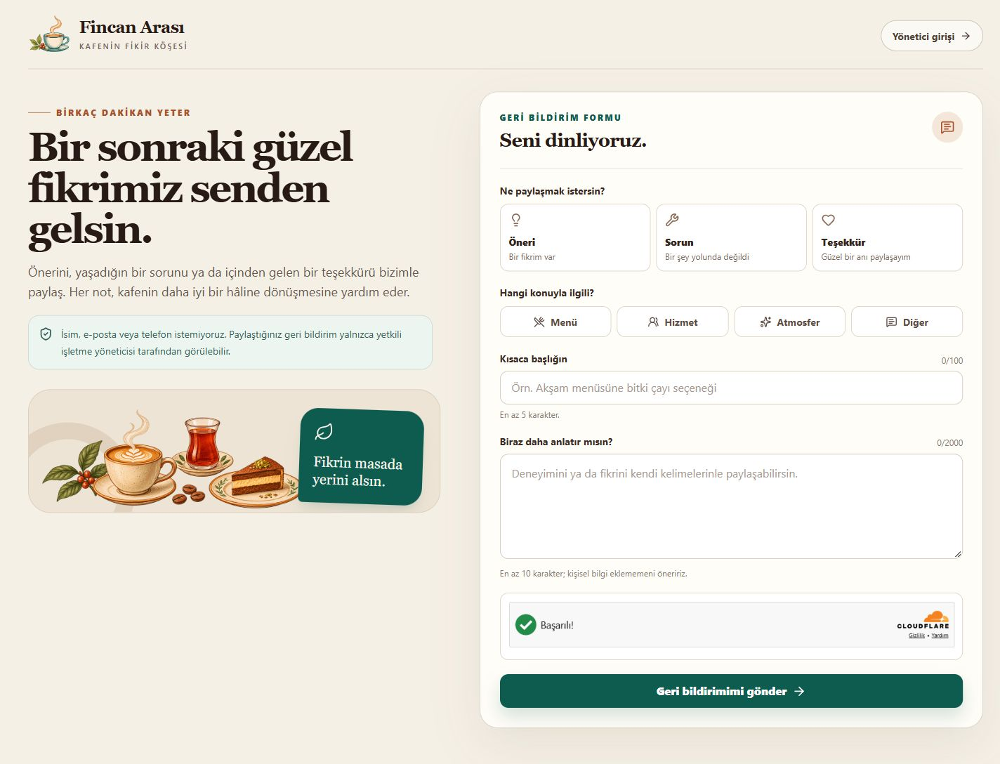

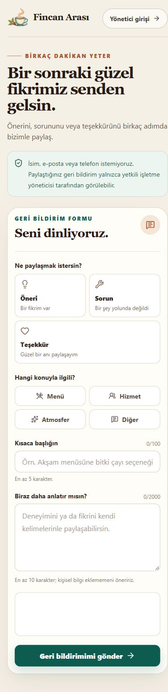

</details>

<details>
<summary><strong>Canlı gönderim başarı durumu</strong></summary>

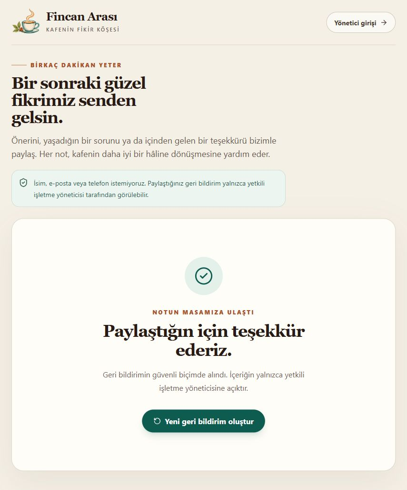

Görselden sonra geçici kayıt ve ilişkili geçmişi silindi; üç `[ÖRNEK]` kayıt kaldı.

</details>

<details>
<summary><strong>Yönetici girişi ve parola kurtarma</strong></summary>

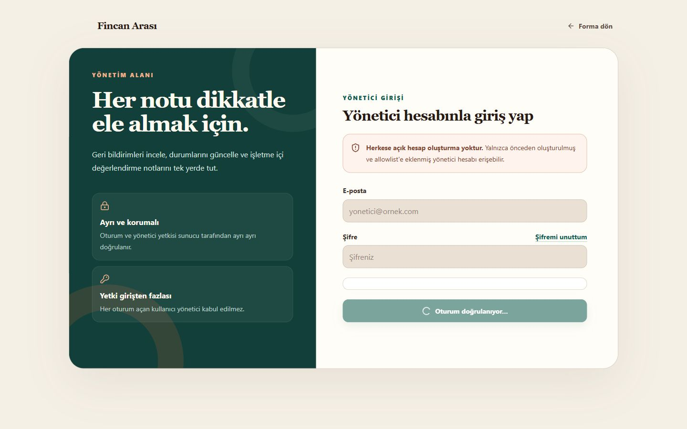

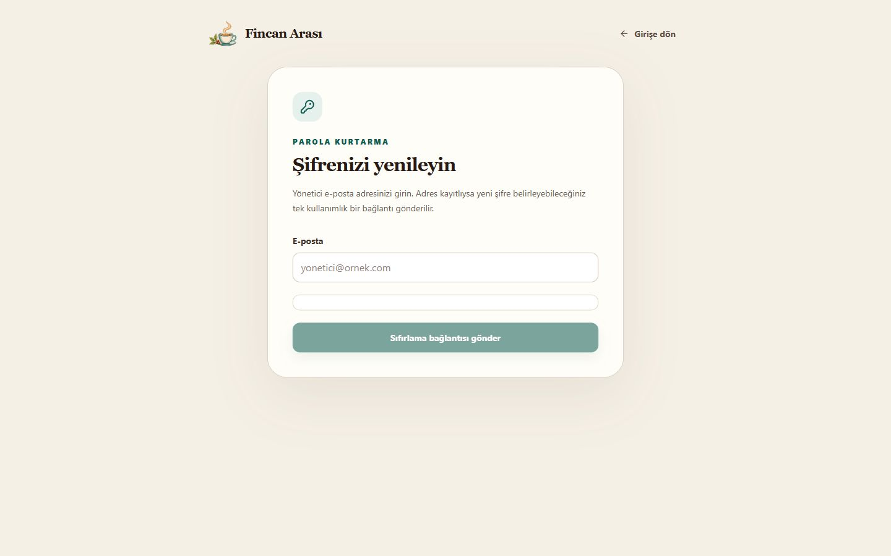

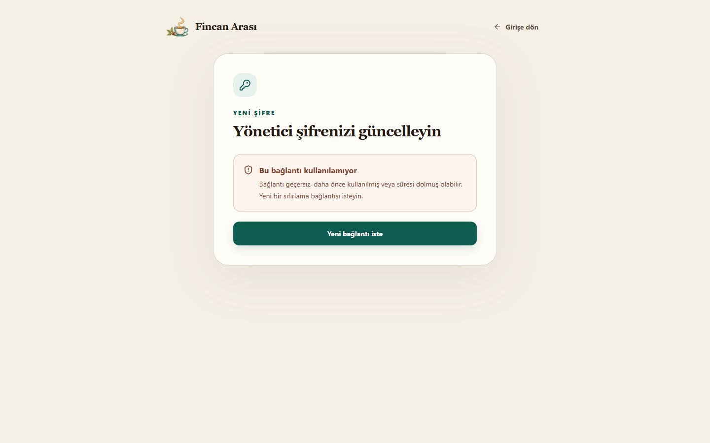

Nötr “İsteğiniz alındı” sonucu ile geçerli yeni-şifre formu bu turda yeniden çekilmedi. İlki yeni CAPTCHA/recovery isteği ve e-posta kotası, ikincisi geçerli tek kullanımlık recovery oturumu gerektiriyordu; gereksiz e-posta üretilmedi ve erişilemeyen durum çekilmiş sayılmadı. Bu iki akışın önceki canlı işlev doğrulaması güvenlik kaydında bulunur.

</details>

<details>
<summary><strong>Yönetici paneli — masaüstü ve mobil</strong></summary>

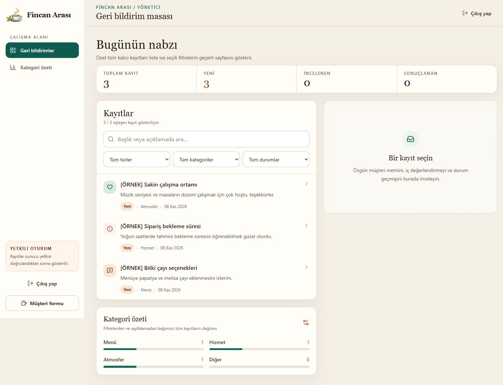

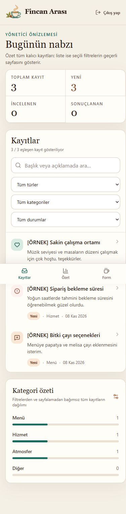

</details>

<details>
<summary><strong>Kayıt detayı, durum, iç not ve geçmiş</strong></summary>

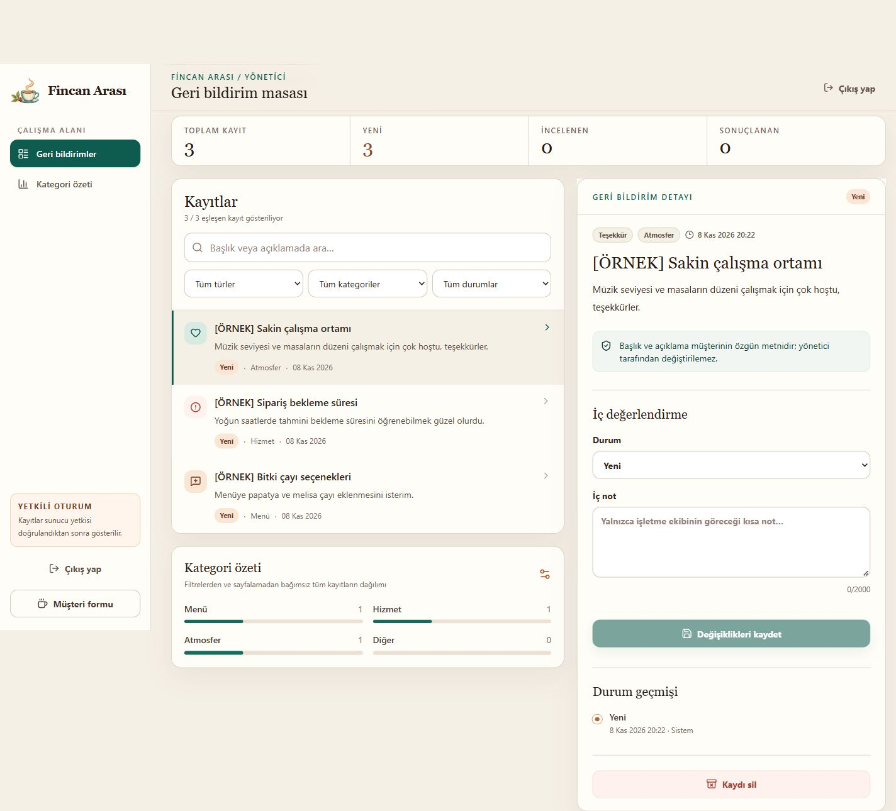

</details>

<details>
<summary><strong>Birleşik arama ve filtre sonucu</strong></summary>

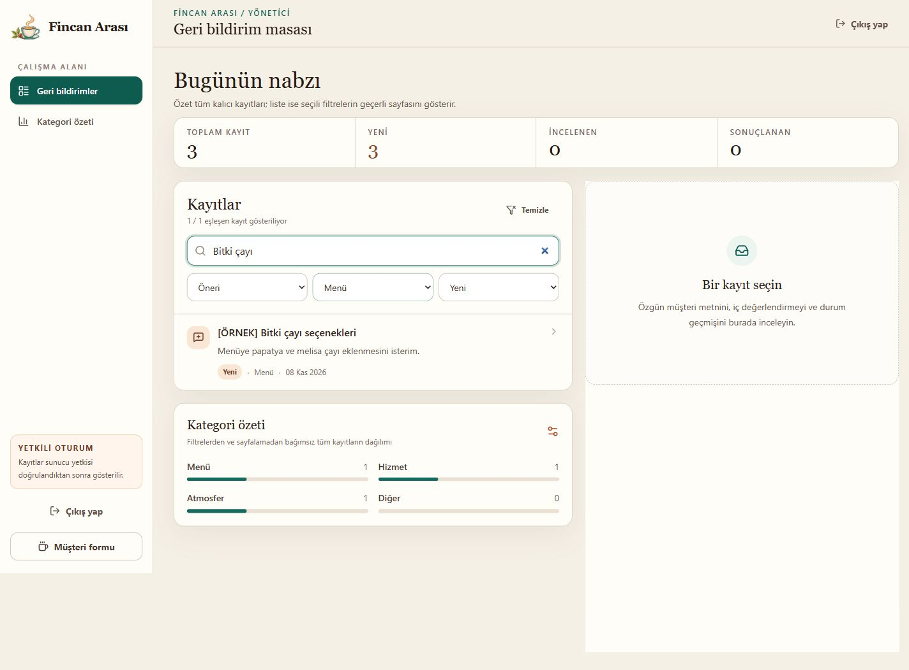

</details>

<details>
<summary><strong>Silme onayı — işlem iptal edildi</strong></summary>

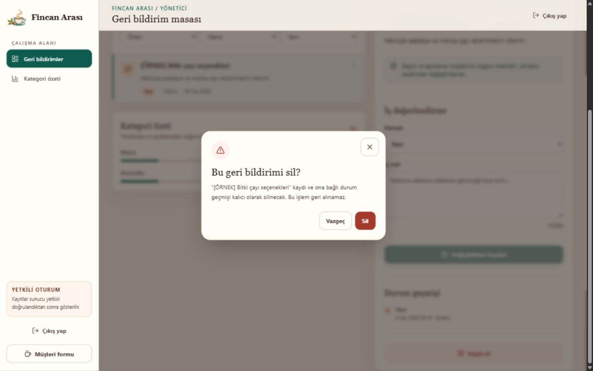

Bu pencerede `Vazgeç` seçildi ve `[ÖRNEK]` kayıt korundu.

</details>

<details>
<summary><strong>404</strong></summary>

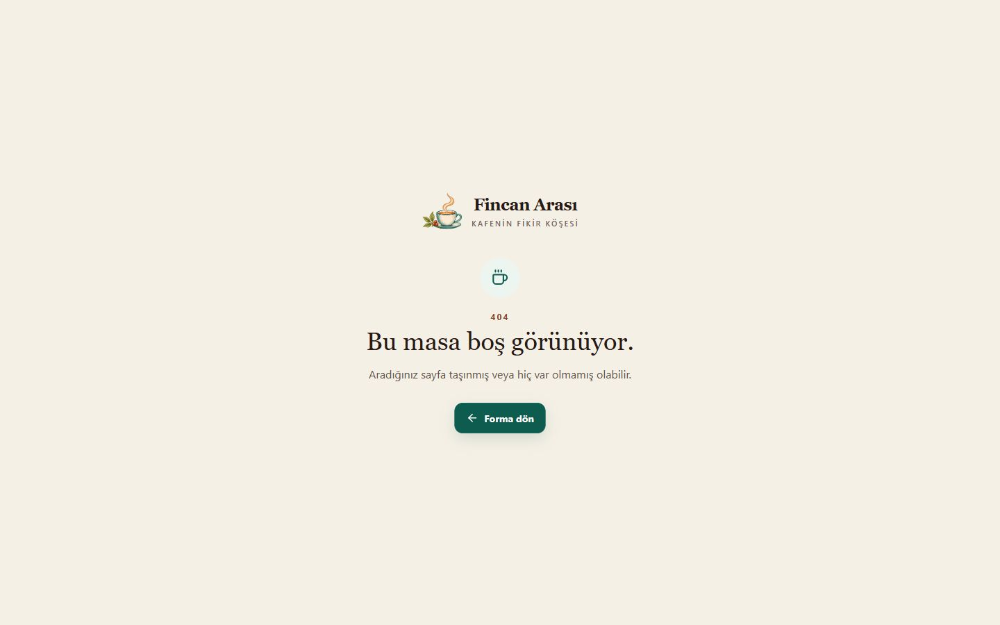

</details>

## Yapay zekâ nasıl kullanıldı?

| Aşama | Kullanılan araç | Alınan destek | Nasıl değerlendirildi / doğrulandı |
| --- | --- | --- | --- |
| Fikir ve kapsam | ChatGPT | Tek kafe/tek yönetici kapsamı, müşteri-yönetici akışları, kabul ölçütleri ve sonraki Codex istemlerinin hazırlanması | Öğrenci kapsamı daralttı; QR/üyelik gibi gereksiz özellikleri dışarıda bıraktı ve her turda yetki sınırlarını onayladı. |
| Kod ve mimari | Codex | React route/bileşenleri, demo-servis ayrımı, Supabase migration/RPC/RLS, Edge Function, Auth/recovery ve Netlify yapılandırması | Diff ve çalışan arayüz incelendi; yerel komutlar, uzak pgTAP/HTTP matrisi ve canlı smoke kontrolleriyle doğrulandı. |
| Hata ayıklama | Codex | 504'e dönüşen stale güncellemenin hızlı `409` çakışmasına çevrilmesi; büyük gövdenin belleğe alınmadan akış sırasında kesilmesi; kullanıcı silinince geçmiş aktör kısıtının korunması; logout sonrası aktif-session kontrolü | Gerçek stale RPC `409/FEEDBACK_CONFLICT`, content-length olmadan 12 KiB istek `413`, 32 pgTAP ve logout sonrası eski token `403` kanıtlarıyla kontrol edildi. |
| Test | Codex | Birim/servis ve pgTAP senaryolarının hazırlanması, test komutlarının çalıştırılması ve sonuçların ayrıştırılması | AI tarafından yazılan test ile çalıştırılmış test ayrıldı: son kayıtta Vitest **42/42**, uzak pgTAP **32/32**; toplamlar birleştirilmedi. |
| Görsel kimlik | Yerleşik görsel üretim aracı | Kullanıcının referansından esinlenen, yazısız logo işareti ve kafe illüstrasyonu | Kullanıcı Fincan Arası yönünü seçti; varlıklar ayrı, yerel ve optimize edildi. Marka/metin HTML olarak kaldı; mobil ve masaüstü arayüzde kontrol edildi. |
| Yayın | Codex + GitHub + Netlify | Secret taraması, public repo/ilk push, `main` dalı bağlantısı, Free plan build ve canlı origin ayarları | GitHub cihaz girişini ve panel/CAPTCHA adımlarını kullanıcı yaptı; canlı commit, HTTPS, header, SPA ve gerçek CRUD ayrı ayrı doğrulandı. |
| Belgeleme | ChatGPT / Codex | README, AI kullanım kaydı, güvenlik kanıtı ve gerçek ekran envanteri | İddialar komut/uzak test/canlı UI kanıtlarıyla eşleştirildi; erişilemeyen ekranlar eksik bırakıldı. |

Gerçek geçmiş istemlerden kısa örnekler:

- “Mevcut Söz Sende projesine devam et. Projeyi yeniden kurma...”
- “[Özetlenmiş istem] Doğru Supabase projesine bağlan; migration, allowlist, Auth, Edge Function ve pgTAP kontrollerini gerçek ortamda tamamla.”
- “Legacy API keys kapatıldı” ve “Turnstile secret düzeltildi” kullanıcı tarafından yapılan panel adımlarının geri bildirimleridir.
- “[Özetlenmiş istem] Fincan Arası referansını kullan; marka metnini HTML bırak, logo ve illüstrasyonu ayrı optimize varlıklar yap.”
- “Hostname kaydedildi, canlı kontrollere devam et.”

İnsan katkısı ayrı tutulur: proje kapsamı, marka adı ve görsel seçimi, ücretsiz/public yayın kararı, Supabase/GitHub/Netlify hesap adımları, gizli değerlerin panellere girilmesi, yönetici şifresi, CAPTCHA'lar ve veri silme onayları kullanıcıya aittir. Kodun tamamının elle yazıldığı veya her kontrolün kullanıcı tarafından manuel yapıldığı iddia edilmez.

Uygulamanın çalışma zamanında AI API'si, sohbet botu, makine öğrenmesi veya derin öğrenme yoktur. Yapay zekâ yalnız geliştirme ve belgeleme aracıdır. Ayrıntılı kayıt: [docs/AI_KULLANIMI.md](./docs/AI_KULLANIMI.md).

## Güvenlik ve ücretsiz hizmet sınırları

- Proje “tamamen güvenli” olarak sınıflandırılmaz. Ayrıntılı durum ve kalan riskler [docs/GUVENLIK_KONTROL.md](./docs/GUVENLIK_KONTROL.md) içindedir.
- Varsayılan Supabase e-posta servisi ders demosu içindir; organizasyon üyeleri, düşük kota ve best-effort teslim sınırları vardır. Özel SMTP/doğrulanmış gönderici alan adı kurulmamıştır.
- Geçerli CAPTCHA altında kayıtlı ve kurgusal kayıt-dışı ilk recovery istekleri aynı nötr sonucu verdi; tekrarlı 60 saniyelik kota/rate-limit zamanlama yan kanalı çalıştırılmadı.
- Logout sonrası uygulama yetkisi aktif-session kontrolüyle kesildi; gerçek bir JWT'nin doğal `exp` süresini bekleyerek gateway reddi ayrıca kanıtlanmadı.
- Netlify Free ve Supabase Free SLA vermez. Netlify kredisi biterse site dönem sonuna kadar durabilir; Supabase düşük etkinlikte yaklaşık yedi günlük pencerede projeyi duraklatabilir. Yapay trafik kurulmaz; kota/pause e-postası ve Dashboard düzenli kontrol edilir.
- Ücretsiz planda iki ay kesintisiz erişilebilirlik garanti edilemez. Yedek, hata izleme ve manuel resume işletim sorumluluğudur; ücretli hizmet açılmamıştır.
- Gerçek ekran okuyucu denemesi ve tüm akışın yalnız klavyeyle baştan sona manuel tekrarı ayrıca beklemektedir.

Kurulum ve uzak doğrulama ayrıntıları [docs/SUPABASE_KURULUM.md](./docs/SUPABASE_KURULUM.md), plan ve işletim maddeleri [docs/PROJE_PLANI.md](./docs/PROJE_PLANI.md) içindedir.
