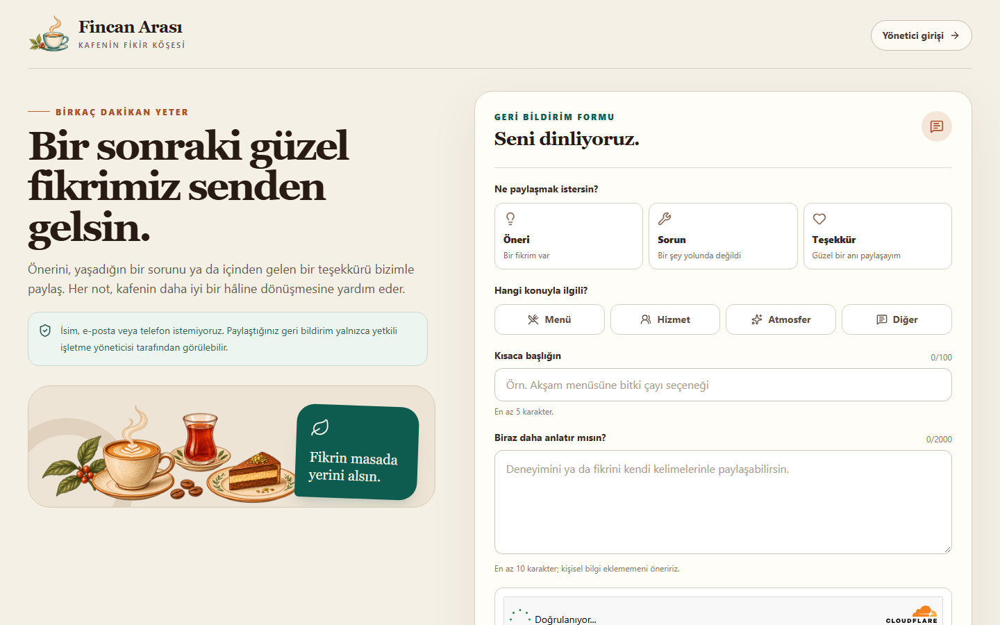

# Fincan Arası

Fincan Arası, tek bir kafe için tasarlanan geri bildirim web uygulamasıdır. Müşteriler hesap oluşturmadan öneri, sorun veya teşekkür iletebilir; işletme yöneticisi ise ayrı bir çalışma alanında kayıtları arayıp filtreleyebilir, durum ve iç not alanlarını yönetebilir.

Bu depo **Aşama 2 uygulamasını** içerir. Aşama 1'in bellek içi demo modu korunmuştur; bunun yanında bağlı Supabase projesinde PostgreSQL migration'ları, Auth tabanlı tek yönetici girişi, parola kurtarma, korumalı RPC'ler ve doğrulanan müşteri Edge Function'ı kurulmuştur. Gerçek yönetici CRUD, yenileme kalıcılığı ve test kaydı temizliği doğrulanmıştır.

Kaynak kodu [GitHub'daki `rna03/fincan-arasi` deposunda](https://github.com/rna03/fincan-arasi) tutulur. Canlı uygulama adresi: [https://fincan-arasi.netlify.app](https://fincan-arasi.netlify.app).

## Özellikler

- Kısa, mobil uyumlu müşteri geri bildirim akışı
- Tür ve kategori seçimi, alan bazlı doğrulama ve karakter sayaçları
- Gönderim, hata ve başarı durumları
- Yönetici için arama, tür/kategori/durum filtreleri ve dinamik özetler
- Kayıt detayı, iç not, durum değişikliği ve durum geçmişi
- Onay isteyen silme akışı
- Yalnız açık geliştirme yapılandırmasında görünen kontrollü demo test durumları
- Supabase Auth e-posta/şifre girişi ve kullanıcıdan ayrı korumalı yönetici allowlist'i
- Hesap varlığını açıklamayan, Turnstile tokenı iletmeye hazır parola kurtarma isteği; yeni şifre ve geçersiz/süresi dolmuş bağlantı ekranları
- RLS + daraltılmış grant'ler + yalnız izin verilen işlemleri sunan RPC katmanı
- Turnstile, kalıcı hız sınırı ve idempotency kullanan public müşteri Edge Function'ı
- Canlı listede sunucu tarafı birleşik filtreleme, 20 kayıtlık sayfalama ve tüm veri kümesini temsil eden özetler
- Klavye odağı, azaltılmış hareket tercihi ve erişilebilir form/modal davranışları hedefi

## Teknolojiler

Kurulum 6 Kasım 2026 tarihinde güncel resmî belgeler ve yerel Node sürümüyle doğrulanan uyumlu hat üzerinden hazırlanmıştır.

| Teknoloji | Sürüm hattı | Kullanım |
| --- | --- | --- |
| React / React DOM | 19.3.1 | Arayüz ve durum yönetimi |
| React Router | 7.18.5 | İstemci tarafı sayfalar |
| Vite | 8.3.6 | Geliştirme sunucusu ve production build |
| Tailwind CSS + Vite eklentisi | 4.3.5 | Stil sistemi |
| Lucide React | 1.70.0 | Tutarlı arayüz ikonları |
| Supabase JS | 2.119.0 | Auth, RPC ve Edge Function istemcisi |
| Vitest | 5.1.0 | Birim ve servis testleri |
| ESLint / @eslint/js | 9.39.5 | Statik kod kontrolü |

Tailwind v4 kurulumu `@tailwindcss/vite` ve CSS içindeki `@import "tailwindcss";` üzerinden yapılır. Eski `tailwindcss init -p` akışı kullanılmaz.

## Gereksinimler

- Node.js **22.18.0 veya üzeri**
- npm 10 veya üzeri

Vite 8 için resmî alt sınır Node 22 hattında 22.12'dir; proje yerelde Node 22.18.0 ile hazırlanmıştır.

## Kurulum ve çalıştırma

```bash
npm install
npm run dev
```

Geliştirme sunucusunun yazdığı yerel adresi tarayıcıda açın. `npm run dev`, veri modunu açıkça `demo` olarak ayarlar; eksik backend yapılandırması nedeniyle sessiz bir demo geri dönüşü yapılmaz.

Diğer komutlar:

```bash
npm run test       # Birim ve demo servis testleri
npm run test:watch # Testleri izleme modunda çalıştırır
npm run lint       # ESLint kontrolü
npm run build      # Demo yapılandırmasıyla production build
npm run preview    # Oluşturulan dist çıktısını yerelde önizler
npm run dev:tools  # Demo hata/yükleme araçlarını açıkça etkinleştirir
npm run dev:live   # Ortam değerleri hazırsa gerçek Supabase veri modu
npm run build:live # Gerçek mod yapılandırmasıyla build; canlı env değerlerini gerektirir
npm run test:db    # Çalışan yerel Supabase stack üzerinde pgTAP güvenlik testleri
```

`dev:live`, URL, publishable key veya Turnstile site key eksikse demoya düşmez; kurulum belgesine yönlendiren açık hata gösterir.

## Yapılandırma

Örnek değerler [.env.example](./.env.example) dosyasındadır.

| Değişken | Açıklama |
| --- | --- |
| `VITE_DATA_MODE` | Zorunlu veri kaynağı seçimi: `demo` veya `supabase` |
| `VITE_ENABLE_DEMO_TOOLS` | Yalnız `true` verildiğinde kontrollü hata/yükleme araçlarını gösterir; normal demo varsayılanı kapalıdır |
| `VITE_SUPABASE_URL` | Aşama 2'de tarayıcının kullanacağı proje URL'si |
| `VITE_SUPABASE_PUBLISHABLE_KEY` | Aşama 2'de tarayıcıda kullanılabilen publishable anahtar |
| `VITE_TURNSTILE_SITE_KEY` | Tarayıcıda kullanılabilen Turnstile site key; gerçek modda zorunlu |

Supabase secret/service-role anahtarı ve Turnstile secret frontend'e, repoya veya `VITE_` değişkenine konmamalıdır. Server-only örnekler `supabase/functions/.env.example` içindedir.

## Sayfalar

| Yol | Amaç |
| --- | --- |
| `/` | Müşteri geri bildirim formu |
| `/yonetici/giris` | Demo modunda ayrı önizleme; gerçek modda Supabase e-posta/şifre girişi |
| `/yonetici/sifremi-unuttum` | Hesap varlığını açıklamayan parola sıfırlama e-postası isteği |
| `/yonetici/sifre-yenile` | Supabase kurtarma bağlantısından yeni şifre belirleme |
| `/yonetici` | Demo veya yetkilendirilmiş Supabase servisiyle çalışan korumalı yönetim paneli |

Demo yönetici önizlemesi şifresizdir ve yalnız Aşama 1 arayüzünü incelemek içindir. Gerçek bir yönetici oturumu veya yetkilendirme kanıtı değildir.

Gerçek modda demo önizleme bağlantısı gösterilmez. Route koruması yalnız veri sızıntısını önleyen bir frontend katmanıdır; asıl yetki kontrolü her RPC içinde ve veritabanı grant/RLS kurallarında yeniden yapılır.

## Demo veri davranışı

Demo servis tek bir uygulama oturumunda müşteri formu ile yönetici panelinin aynı kayıtları görmesini sağlar. Ekleme, okuma, yönetici alanlarını güncelleme ve silme işlemleri yalnızca tarayıcı belleğinde gerçekleşir.

- Tam sayfa yenilendiğinde veriler başlangıç örneklerine döner.
- React Router bağlantıları tam sayfa yenilemeden geçiş yapar; bu nedenle müşteri gönderimi aynı SPA oturumunda yönetici önizlemesinde görünür.
- Demo başarıları gerçek veritabanı yazımı veya gerçek yetkilendirme anlamına gelmez.
- Hatalar rastgele üretilmez; yalnız `npm run dev:tools` veya servis testi tarafından açıkça tetiklenir.
- Aynı durum tekrar kaydedildiğinde gereksiz durum geçmişi oluşturulmaması hedeflenir ve test edilir.

Demo ekranında gerçek veya kişisel bilgi girilmemelidir. “Yalnızca işletme yetkilisi görür” güvencesi demo için kullanılmaz; gerçek modda erişim Supabase Auth, aktif session, allowlist ve yönetici RPC kontrolleriyle uygulanır.

## Netlify yayın yapılandırması

Kök dizindeki `netlify.toml` teslim ayarlarını sabitler:

| Ayar | Değer |
| --- | --- |
| Build komutu | `npm run build:live` |
| Yayın klasörü | `dist` |
| Node hattı | `22` |

Netlify projesi GitHub `main` dalına sürekli yayın için bağlanmıştır. Production origin'i `https://fincan-arasi.netlify.app`; Supabase Auth Site URL, tam recovery redirect yolu ve Edge origin/hostname allowlist'i bu adresle sınırlandırılmıştır.

`public/_redirects`, React Router yollarını doğrudan açma ve yenileme için `index.html` SPA fallback'ini sağlar. `public/_headers` CSP, HSTS, `nosniff`, frame, referrer ve Permissions-Policy başlıklarını içerir. Vite build sırasında iki dosya da `dist/` içine kopyalanır.

Netlify build ortamında yalnız şu browser-safe frontend değişkenleri tanımlanmalıdır:

- `VITE_SUPABASE_URL`
- `VITE_SUPABASE_PUBLISHABLE_KEY`
- `VITE_TURNSTILE_SITE_KEY`

`VITE_DATA_MODE` değerini `build:live` komutu `supabase` olarak sabitler. `VITE_ENABLE_DEMO_TOOLS` canlı build'de etkinleştirilmemelidir. `SUPABASE_SECRET_KEYS`, `TURNSTILE_SECRET_KEY`, `RATE_LIMIT_HASH_SECRET` ve diğer server secret'ları Netlify frontend ortamına konmaz; Supabase Edge Function ortamında kalır.

### Varsayılan Auth e-posta servisinin sınırları

Bu ders demosunda özel SMTP sağlayıcısı kurulmamıştır. Supabase'in varsayılan e-posta servisi yalnız proje organizasyonunun ekip üyesi olan önceden yetkilendirilmiş adreslere gönderim yapar; mevcut sınır proje başına saatte **2 e-posta**dır ve sağlayıcı tarafından değiştirilebilir. Hizmet best-effort çalışır, teslim/çalışabilirlik SLA'sı sunmaz ve üretim kullanımı için tasarlanmamıştır. Gerçek yönetici adresi organizasyona eklenerek tek parola-kurtarma e-postası başarıyla teslim edilmiştir.

Geçerli CAPTCHA altında kayıtlı ve kurgusal kayıt-dışı ilk recovery istekleri aynı başarılı HTTP ve nötr arayüz sonucunu vermiştir. E-posta kotasını tüketmemek için 60 saniyelik kullanıcı penceresindeki tekrarlı yanıt matrisi çalıştırılmadı; bu zamanlama kaynaklı hesap-varlığı riski açık tutulur. Gerçek müşteri yayını öncesinde doğrulanmış gönderici alan adı olan özel SMTP ve yeniden regresyon testi gerekir. Güncel sınırlar için [Supabase Auth SMTP rehberine](https://supabase.com/docs/guides/auth/auth-smtp) bakın.

### Ücretsiz planlarda iki aylık erişilebilirlik ve bakım

Bu ders yayını ücretli SLA içermez; iki ay kesintisiz erişilebilirlik **garanti edilemez**. Güncel Netlify Free hesabı ayda 300 kredi verir; production deploy başına 15, bant genişliği için GB başına 20 ve 10.000 web isteği başına 2 kredi tüketilir. Kredi biterse hesaptaki siteler bir sonraki fatura dönemine kadar duraklar. Bu nedenle gereksiz production deploy yapılmamalı ve Netlify **Usage & billing** ekranı haftalık kontrol edilmelidir. Kaynak: [Netlify kredi rehberi](https://docs.netlify.com/manage/accounts-and-billing/billing/billing-for-credit-based-plans/how-credits-work/).

Supabase Free; proje başına 500 MB veritabanı, organizasyon için 50.000 MAU, 5 GB normal + 5 GB cached egress ve 500.000 Edge Function çağrısı kotası sunar. Düşük etkinlik gösteren ücretsiz projeler yaklaşık yedi günlük pencerede otomatik duraklatılabilir; duraklatılan proje veri ve ayarlarını korur ve Dashboard'dan bir yıl içinde geri alınabilir. İki aylık dönem boyunca her 5–6 günde bir gerçek bakım amacıyla Supabase Dashboard'da proje durumu ve kota ekranı kontrol edilmeli, uyarı e-postaları izlenmeli; otomatik keep-alive veya yapay trafik üretilmemelidir. Free planda otomatik indirilebilir günlük yedek güvencesi olmadığından düzenli şifreli mantıksal dump ayrı konumda saklanmalıdır. Kaynaklar: [Supabase Free kotaları](https://supabase.com/docs/guides/platform/billing-on-supabase), [proje duraklatma](https://supabase.com/docs/guides/platform/free-project-pausing), [yedekleme](https://supabase.com/docs/guides/platform/backups).

## Dosya ve veri akışı

```text
src/pages + src/components
           │
           ▼
    FeedbackContext
           ├── demoFeedbackService ──> modül belleğindeki kurgusal kayıtlar
           │
           └── supabaseFeedbackService
                    ├── müşteri ──> submit-feedback Edge Function
                    └── yönetici ──> Supabase Auth + korumalı RPC'ler
```

Ana klasörler:

```text
docs/                  Proje planı ve AI kullanım kaydı
public/                Statik dosyalar ve Netlify SPA yönlendirmesi
src/components/        Ortak arayüz bileşenleri
src/context/           Sayfalarla servis arasındaki ortak durum
src/data/              Kurgusal başlangıç kayıtları
src/pages/             Müşteri, giriş ve yönetici sayfaları
src/services/          Değiştirilebilir veri servisi katmanı
src/utils/             Doğrulama ve yardımcı fonksiyonlar
supabase/migrations/   Şema, RLS, grant ve sınırlı RPC migration'ları
supabase/functions/    Müşteri gönderimi Edge Function'ı
supabase/tests/        pgTAP veritabanı güvenlik testleri
```

Detaylı mimari, izin matrisi, veri modeli ve dört aşamalı yol haritası [docs/PROJE_PLANI.md](./docs/PROJE_PLANI.md) içindedir.
Gerçek proje kurulumu ve doğrulama sırası [docs/SUPABASE_KURULUM.md](./docs/SUPABASE_KURULUM.md) içindedir.

## Test ve kalite kontrolleri

9 Kasım 2026 tarihli son doğrulamada:

- `npm run test`: **42/42 test geçti**. Demo servis, form doğrulama, Supabase servis sözleşmesi, Auth CAPTCHA token aktarımı/eksik-token ve sağlayıcı hata eşleme kontrolleri, global logout, parola kurtarma URL durumları, geçmiş aktör etiketi ve Edge Function yardımcıları kapsandı.
- `npm run lint`: **uyarı ve hata olmadan geçti**.
- `npm run build`: **Vite production build geçti**.
- `npm run build:live`: Yerel browser-safe proje URL/publishable/site key ile **derleme geçti**; build içinde server secret/service-role değeri bulunmadı.
- 390 × 844 px ve 1440 × 900 px tarayıcı kontrolleri yapıldı.
- Müşteri gönderiminin aynı SPA oturumunda yönetici listesine gelmesi doğrulandı.
- Arama + tür + kategori + durum filtrelerinin birlikte çalışması doğrulandı.
- Durum/not güncellemesinin liste, detay, geçmiş ve özet sayılarına yansıması doğrulandı.
- Aynı durumla ikinci not kaydının yeni geçmiş satırı üretmediği doğrulandı.
- Silme modalında “Vazgeç” sonrası kaydın korunduğu tarayıcıda; onaylı silmenin kayıtla gömülü geçmişi kaldırdığı servis testinde doğrulandı.
- Gerçek tam sayfa yenilemede demo belleğinin başlangıç verisine dönmesi tasarlanan davranıştır; kalıcılık iddiası yoktur.
- `supabase/tests/database/feedback_security_test.sql` içinde aktif Auth session kontrolü dahil 32 pgTAP kontrolü hazırlandı.
- Uzak PostgreSQL üzerinde transaction içindeki **32/32 pgTAP** kontrolü geçti ve test kayıtları rollback ile temiz kaldı.
- Düzeltilen Turnstile secret ile gerçek form tek kurgusal kayıt oluşturdu; çift kayıt oluşmadı. Parola kurtarma, allowlist yönetici girişi, durum/iç not güncellemesi, liste-detay-özet-geçmiş tutarlılığı ve gerçek yenileme kalıcılığı doğrulandı. Yalnız test kaydı geçmişiyle silindi.

Kontrolleri yeniden çalıştırmak için:

```bash
npm run test
npm run lint
npm run build
```

Gerçek ekran okuyucu denemesi ve bütün akışın yalnız klavyeyle baştan sona manuel tekrarı henüz ayrıca yapılmamıştır.

## Bağımlılık güvenliği

7 Kasım 2026 son kontrolünde tam `npm audit`, toplam 204 paket için üretim ve geliştirme zincirinde **0 güvenlik bildirimi** verdi. `npm audit fix --force` kullanılmadı. Semver uyumlu bakım güncellemeleriyle Tailwind paketleri 4.3.5'e ve `@vitejs/plugin-react` 6.2.1'e alındı. ESLint 10 ve `@eslint/js` 10 major yükseltmeleri güvenlik düzeltmesi gerektirmediği ve kırıcı değişiklik riski taşıdığı için otomatik uygulanmadı.

## Ekran görüntüsü

Fincan Arası müşteri ekranı gerçek yerel uygulamadan 390 ve 1440 px görünüm genişliklerinde kaydedildi:

- [390 px müşteri görünümü](./docs/screenshots/fincan-arasi-musteri-390.png)
- [1440 px müşteri görünümü](./docs/screenshots/fincan-arasi-musteri-1440.png)



Yönetici paneli de aynı iki genişlikte canlı tarayıcıda görsel olarak kontrol edildi; oturum içeren yönetici görünümü teslim görsellerine eklenmedi.

## Aşama 2 güvenlik durumu

Yerel kaynak kodunda şunlar hazırdır:

- Sürüm kontrollü PostgreSQL şeması, kısıtlar, indeksler, sunucu zamanları ve `ON DELETE CASCADE` geçmiş ilişkisi
- Data API'den açık olmayan `private.admin_allowlist`; kullanıcı tarafından değiştirilemeyen güvenilir kurulum adımı
- `anon`/`authenticated` doğrudan tablo grant'lerinin kaldırılması ve savunma katmanı RLS politikaları
- Her çağrıda `auth.uid()` + allowlist kontrolü yapan, boş `search_path` kullanan sınırlı yönetici RPC'leri
- Yalnız `status`/`admin_note` güncellemesi, transaction içi durum geçmişi ve `updated_at` çakışma kontrolü
- Public müşteri Edge Function'ında yöntem/içerik/gövde/enum/uzunluk kontrolü, Turnstile Siteverify, HMAC IP özetiyle kalıcı rate limit ve veritabanı tekilliğiyle idempotency
- Başarılı müşteri yanıtında kayıt veya yönetici verisi döndürmeme; hata yanıtında SQL/secret ayrıntısı açmama
- Auth olgunlaşmadan veri yüklemeyen route guard ve çıkış/oturum sonlanmasında hassas React state temizliği

Gerçek anonim/allowlist dışı/yönetici matrisi, küçük HTTP rate-limit, eşzamanlı idempotency ve son Edge sürümünde gerçek Turnstile başarı/replay/315 saniye expiry tamamlandı. Yönetici RPC'leri aktif Auth session satırını da zorunlu tutuyor; gerçek global logout sonrası eski access token 403 aldı. Auth CAPTCHA için eksik/geçersiz token reddi, insan doğrulamalı yönetici girişi ve varsayılan SMTP ile tek recovery teslimi doğrulandı. Geçerli token altında kayıtlı ve kurgusal kayıt-dışı recovery ilk istekleri aynı başarılı HTTP/nötr UI sonucunu verdi; tekrarlı rate-limit zamanlaması açık risktir. Kalanlar production hostname/origin/HTTPS/header kontrolü ve yedek/izleme prosedürüdür. Ayrıntılı kanıt ve kalan riskler [docs/GUVENLIK_KONTROL.md](./docs/GUVENLIK_KONTROL.md) dosyasındadır. Frontend route koruması sunucu yetkilendirmesinin yerine geçmez; proje “tamamen güvenli” olarak sınıflandırılmaz.

## Yapay zekâ kullanımı

Proje fikri, kullanıcı akışları, veri modeli, güvenlik mimarisi, tasarım sistemi, örnek veriler, kod ve test taslakları yapay zekâ destekli geliştirme ortamıyla birlikte hazırlanmıştır. Uygulamanın çalışma zamanında AI API'si veya otomatik karar veren bir model yoktur. Ne üretildiği, hangi kararların insan doğrulaması gerektirdiği ve sınırlar [docs/AI_KULLANIMI.md](./docs/AI_KULLANIMI.md) dosyasında açıklanır.

## Teslim durumu

Aşama 2'nin kodu, dört uzak migration'ı, sertleştirilmiş Edge Function'ı, parola kurtarma akışı, gerçek yetki/CRUD/rate-limit/idempotency/Turnstile/logout kontrolleri ve güvenlik belgesi hazırdır. Geçici güvenlik test kullanıcıları ile ilişkili test verileri temizlenmiştir. Kullanıcının onayıyla oluşturulan üç `[ÖRNEK]` sunum kaydı veritabanında kalır; yönetici bilgileri repoda yer almaz. GitHub deposu ve Netlify CI/CD bağlantısı kurulmuştur; canlı doğrulama sonuçları güvenlik ve proje planı belgelerinde tutulur.
